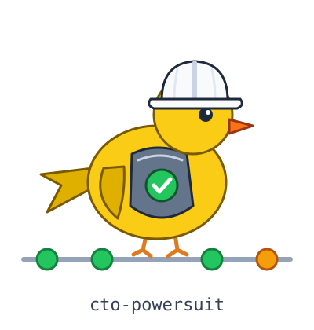

**English** · [Deutsch](README_de.md)

# cto-powersuit

<p align="center"></p>

[](https://github.com/uncovertechtalent/cto-powersuit/actions/workflows/checks.yml) [](https://skills.sh/uncovertechtalent/cto-powersuit)

**The CTO powersuit is a set of agent skills, one module per CTO function from the deploy gate to the hand-over, that one person uses to run a company's whole engineering platform.**

by [Stefan Coetzee](https://machinebehavior.io/your-next-cto/)

The modules ship as one Claude Code plugin marketplace, one plugin per function, and also install with the skills CLI. A team installs the modules it needs and runs them on generic defaults.

Each skill also reads a private overlay when one exists: your own data for that module, kept outside the repository. See [Overlay](#overlay-your-private-layer).

## Who runs it

The CTO powersuit is the open-source toolkit behind CAITO, the fractional Chief AI & Technology Officer role that Stefan Coetzee offers on machinebehavior.io: one role for the technology platform and the AI that runs on it, filled part-time, with the CTO and the AI operations owner in one seat. The plugin pages, one per module, are at [machinebehavior.io/cto-powersuit/](https://machinebehavior.io/cto-powersuit/). The hire page, with the engagement shapes and what a first quarter delivers, is at [machinebehavior.io/your-next-cto/](https://machinebehavior.io/your-next-cto/).

## Three ways to use it

1. **Run it yourself.** Your team installs the modules from this repository and runs them on its own. See [Install](#install).
2. **Call for help.** When your team gets stuck, Stefan Coetzee does an assessment or the install.
3. **Hire Stefan Coetzee as your fractional CTO.** He runs the powersuit for your company, with his own research and data in a private overlay on top of the open modules. That overlay stays out of this repository.

For the second and third way: [machinebehavior.io/your-next-cto/](https://machinebehavior.io/your-next-cto/).

## Modules

| Plugin | What it does | Needs |
|---|---|---|
| `ai-ops` | Operations for a team's coding agents: a shared harness with narrow permissions, agent spend metered per API request with a budget alert, an audit trail of every tool call with who allowed or denied it and an alert on a spike of denied calls, and a coordinator pattern with state in files. `vestige`, `stance` and `vault` are its optional parts. A gate check that shared agent settings carry no secrets and no wildcard permissions. | Python 3.9+; `observability` for metering and the audit trail |
| `aieo` | Visibility in AI search: `llms.txt`, structured data, a fixed query set probed against AI search engines, and dated predictions hashed before a page goes live. A gate check that every prediction file matches its hash. | Python 3.9+ |
| `compliance` | A control map to ISO 27001, TISAX, NIS2 and GDPR by clause and article number, an AI Act triage, and a legal baseline for a website (Impressum, privacy page, security.txt, no third-party requests on page load). Gate checks for security.txt and third-party requests. | Python 3.9+ |
| `decisions` | RFCs, architecture decision records (ADRs) and a review of the decision log. Templates for both records and a gate check that every ADR has a status, an owner and a date. | Python 3.9+ for the gate check |
| `direction` | The direction area: a weekly review that reads the tracker across all areas and writes a memo (what moved per area, what is blocked, the proposed allocation of the week, the decisions needed), and records each confirmed decision as a tracker item. A gate check that every review memo names its date and period, carries the four sections, and gives every decision a status. | Python 3.9+ for the gate check; `bd` (beads) |
| `docs` | A docs tree where every page has an owner and review dates, runbooks, and a sweep for stale pages. A static docs build and a gate check on the review fields. | Python 3.9+ |
| `finops` | A cost baseline from invoices and billing exports, showback per team or service, unit costs, a SaaS stack audit (keep, cut or replace) and a FOCUS export. A gate check that every cost figure in the docs carries a date range and a source. | Python 3.9+ |
| `fit` | The entry assessment: reads a repository and its docs, runs the sdlc audit, and recommends which modules to fit and in which order. A repo clinic that audits a public repository at its owner's request and drafts one short report with the top three gaps and one small pull request, with secrets and security holes kept to a private note. A review's findings filed as GitHub Issues in the company's own repository, labelled by area, kind and severity, with a dry run first and a scorecard per area. A gate check that every module marked fitted is installed. | `sdlc`; `gate` and `security` for the clinic; Python 3.9+, and `gh` with triage or write access for `/fit:file-findings --create` |
| `gate` | A deploy gate: a rules folder with pass and fail fixtures per rule, run records, findings that close only on a passing rerun, and a workflow whose deploy job waits for the gate and for the repository's own test command, which you name and which stays on `warn` until a false-positive test is recorded. The checks of the other modules run in it. Gate checks that every blocking rule has working fixtures and that every action from outside the repository is pinned to a commit SHA. | Python 3.9+, GitHub Actions for the workflow |
| `handover` | Hand the platform to its owner: training checklists per installed module, exit criteria, and a test plan proving the owner runs the platform from the docs alone. A gate check that every installed module has a named owner. | Python 3.9+ for the gate check |
| `hiring` | An interview loop where each stage collects one signal, rubrics with anchored levels, debriefs with evidence before votes, and the profile of the person who takes over the platform. A gate check that every rubric dimension has anchored levels. | Python 3.9+ for the gate check |
| `observability` | Alloy, Prometheus, Loki, Grafana and Alertmanager with docker compose, dashboards as code, and alert routes. A gate check that every alert rule names a route and a runbook. | Docker, Python 3.9+ |
| `red-team` | Pressure tests for a team's AI features: pick the tactics, run scripted multi-turn pressure in a world with a known right answer, and grade the decision the system took. A gate check that every run record names the expected and the observed decision. | Python 3.9+ |
| `reliability` | Availability targets per service with the downtime each target allows, SLOs and error budgets, incident and postmortem runs, a static status page, an on-call policy, a backup inventory with restore tests, and a change record on each server that every ssh connection points to. A gate check that every service in the catalogue has an owner, an SLO, and a runbook, and a second one that reports a data store whose backup inventory records no copy outside the reach of production administrators, no passed restore test, or a restore time above its target. | Python 3.9+ |
| `sdlc` | The lifecycle that ties the modules together: an audit that ranks the missing stages of a repository built without one, the lifecycle map, tickets, change review for agent-written code (`change-review`), a local CI run before each push (`pre-push`, with preloop), test strategy, and release with rollback. A gate check that every change names a ticket or a decision. | Python 3.9+, git; preloop for `pre-push` (optional) |
| `security` | Security for a repository and its coding agents: actions pinned by commit SHA and limited to an owner allowlist, a vulnerability scan of the lock files and an SBOM, a provenance check before anyone installs an agent skill or an MCP server, key-rotation runbooks, a read-only access review that finds merges past the required review and organisation members without two-factor authentication, an inventory of every admin entrance (cloud consoles, identity provider, VPN, DNS registrar, password manager, SaaS admin consoles) with its owner, its multi-factor method and its dated exceptions, threat models per RFC, and vulnerability tickets with fix-by dates. A pre-push hook that refuses a push that adds a secret or a `.env` file, with an allow file that needs a reason per entry. Gate checks for secrets in tracked files, for action owners, and for admin entrances, and a pre-push hook that keeps private terms (names, internal shorthand, private hosts) out of public repositories, with the term list kept on your machine. A quarantine that keeps third-party text away from agents that hold tools: a store outside every indexed folder, a reader model with no tools, and a hook that denies every other read. Zero trust is the principle: nothing is trusted because of where it comes from (inputs, identities, dependencies, reports); each is verified where it is used, and every actor gets the least access its job needs. | Python 3.9+, `gh`; osv-scanner optional; ollama for the quarantine reader |

## Knowledge infrastructure

These three plugins are the knowledge infrastructure layer and the optional parts of the `ai-ops` module ([what knowledge infrastructure for LLMs means](https://coetzeestefan.substack.com/p/knowledge-infrastructure-for-llms)). `vault` is the knowledge base and its retrieval, `vestige` enforces your rules at the output boundary, and `stance` adds boundary rules plus verification through the receipts standard. Each one replaces a manual install (copy files into `~/.claude/`, then edit `settings.json` by hand) with two commands.

| Plugin | What it does | Needs |
|---|---|---|
| `vestige` | An output filter you calibrate to yourself. `/vestige:calibrate` mines your own transcripts for the moments you pushed back and builds your catalog from them. Hooks scan every reply and every Markdown file Claude writes. | Node 14+ |
| `vault` | A plain-Markdown vault with hybrid keyword and semantic search, served to Claude as an MCP server. Skills to create the vault, seed it from an interview and atomize documents into it. | [uv](https://docs.astral.sh/uv/) (Python 3.12+) |
| `stance` | Stance filters against the trained accommodation reflex: `professional-b2` (plain register, no politeness vestiges), `good-chad` (holds position under pushback, no grovel), `receipts` (probe before you assert), `poles` (decisions without the hedge) and `mode-leak` (speech devices in writing). | Node 14+, bash |

The plugins are independent. Install the ones you need. Each module works without the others; the gate checks of the modules need `gate` to run in CI. On an existing repository, start with `/sdlc:sdlc-audit`: it needs no other module and names the module that fills each gap.

## Install

The only source of this project is [github.com/uncovertechtalent/cto-powersuit](https://github.com/uncovertechtalent/cto-powersuit). Install it only with the two owner-qualified commands below, `claude plugin marketplace add uncovertechtalent/cto-powersuit` and `npx skills add uncovertechtalent/cto-powersuit`, or from a clone of that repository. Releases are git tags with release notes. Every release after v0.1.0 also carries a source tarball of its tag, the tarball's sha256, and a build provenance attestation, so you can check a copy against this repository ([Versions and rollback](#versions-and-rollback)). The tarball is for checking, not a way to install. A copy elsewhere that offers a download button is not this project. To check any other skill or MCP server before you install it, use the provenance check of the security module: [`/security:supply-chain`](plugins/security/skills/supply-chain/SKILL.md), step 7.

```bash
claude plugin marketplace add uncovertechtalent/cto-powersuit
claude plugin install ai-ops@cto-powersuit
claude plugin install aieo@cto-powersuit
claude plugin install compliance@cto-powersuit
claude plugin install decisions@cto-powersuit
claude plugin install direction@cto-powersuit
claude plugin install docs@cto-powersuit
claude plugin install finops@cto-powersuit
claude plugin install fit@cto-powersuit
claude plugin install gate@cto-powersuit
claude plugin install handover@cto-powersuit
claude plugin install hiring@cto-powersuit
claude plugin install observability@cto-powersuit
claude plugin install red-team@cto-powersuit
claude plugin install reliability@cto-powersuit
claude plugin install sdlc@cto-powersuit
claude plugin install security@cto-powersuit
claude plugin install vestige@cto-powersuit
claude plugin install vault@cto-powersuit
claude plugin install stance@cto-powersuit
```

Inside Claude Code the same works as `/plugin marketplace add ...` and `/plugin install ...`. Restart Claude Code after installing.

From a local clone: `claude plugin marketplace add /path/to/cto-powersuit`.

With the [skills CLI](https://skills.sh), for Claude Code and other agents:

```bash
npx skills add uncovertechtalent/cto-powersuit
```

The skills CLI copies the skill folders only. Skills that copy templates, the hooks and the MCP server need the plugin install above or a clone of this repository.

## Versions and rollback

Each release is a git tag `v<version>` on `main` with an entry in [CHANGELOG.md](CHANGELOG.md). The suit version sits in `.claude-plugin/marketplace.json` under `metadata.version`. Each plugin keeps its own version in its `plugin.json`, and a release raises the version of every plugin whose files changed since the last tag. `claude plugin update` compares that version only, so CI fails a change to a plugin that does not raise it.

The install commands above follow `main`. To pin a release, add its tag to the source:

```bash
claude plugin marketplace add uncovertechtalent/cto-powersuit#v0.4.0
npx skills add uncovertechtalent/cto-powersuit#v0.4.0
```

Both installers pass the ref to `git clone --branch`, so a tag or a branch name works and a commit SHA does not. `claude plugin marketplace update` stays on the pinned tag. The skills CLI writes the ref to `skills-lock.json`, and `npx skills update` keeps it.

To roll back, or to move a pin to another release, remove the marketplace, add it again at the release you want, and install the plugins again. Removing the marketplace uninstalls its plugins and deletes their saved options, so note options such as the `vault` path first. Changing the `ref` in `settings.json` by hand does not move the pin: in a test with Claude Code 2.1.286 the marketplace then went missing.

```bash
claude plugin marketplace remove cto-powersuit
claude plugin marketplace add uncovertechtalent/cto-powersuit#v0.1.0
claude plugin install sdlc@cto-powersuit
```

With the skills CLI, run `npx skills add` again with the tag you want. It overwrites the installed skills and the ref in `skills-lock.json`.

These commands were tested with Claude Code 2.1.286 and skills 1.7.2.

Every release after v0.1.0 carries two files: `cto-powersuit-<version>.tar.gz`, a `git archive` of the tag, and `cto-powersuit-<version>.tar.gz.sha256`. When a tag is pushed, the release workflow ([`.github/workflows/release.yml`](.github/workflows/release.yml)) checks the release metadata, builds both files, attests them with build provenance, and attaches them to the GitHub release. If the release does not exist yet, the workflow creates it with the tag's section of the changelog as its notes. v0.1.0 was tagged before the workflow existed and has neither files nor an attestation. To check a file you downloaded:

```bash
gh attestation verify cto-powersuit-<version>.tar.gz --repo uncovertechtalent/cto-powersuit
sha256sum -c cto-powersuit-<version>.tar.gz.sha256
```

`gh attestation verify` checks the Sigstore signature and that the workflow that signed it ran in this repository. Add `--signer-workflow uncovertechtalent/cto-powersuit/.github/workflows/release.yml` to require this release workflow. On macOS, use `shasum -a 256 -c` for the second command. The provenance check of the security module ([`/security:supply-chain`](plugins/security/skills/supply-chain/SKILL.md)) does not flag an attested release asset as an unverified binary. It reads that the attestation exists and leaves the signature to `gh attestation verify`. An attestation shows which repository's workflow built the file, not whether that repository deserves trust; the other signals of the check grade that.

## Overlay: your private layer

Every skill in this repository works on generic defaults. Each one also checks for an overlay: a folder you keep outside the repository with your own data for that module, such as rubrics, calibrations, past decisions, incident history and local conventions.

Set `POWERSUIT_OVERLAY` to the overlay root, in your shell or in the `env` block of `settings.json`. One folder per module, named after the plugin:

```text
$POWERSUIT_OVERLAY/
  decisions/
    README.md      what this overlay holds; every skill in the module reads it first
    adr/           files for one skill, named after the skill
  docs/
  gate/
  vestige/
```

Read order for skill `<skill>` in module `<module>`:

1. `$POWERSUIT_OVERLAY/<module>/README.md`, if present.
2. `$POWERSUIT_OVERLAY/<module>/<skill>/`, if present.
3. The defaults in the skill itself.

Where the overlay and the skill disagree, the skill follows the overlay. With the variable unset or the module folder missing, the skill runs on its defaults and does not ask for an overlay.

Nothing from an overlay goes into this repository. Keep it in a private location with no public remote. A team that installs the modules builds its own overlay over time from its decisions, incidents, docs and cost history.

## Module layout

Each module is one plugin under `plugins/<module>/` with four parts:

| Part | Path in the plugin | What it is |
|---|---|---|
| Skills | `skills/<skill>/SKILL.md` | One task per skill, in the Agent Skills format. Every skill checks the overlay first. |
| Templates | `templates/` | Files that land in the client repository, laid out at the paths they take there. Skills copy them and never overwrite an existing file. |
| Gate check | `checks/<rule>.py`, `checks/fixtures/<rule-id>/pass/` and `fail/` | A rule the deploy gate of the `gate` module can run. The two fixtures are small repository trees: the rule must pass on `pass/` and fail on `fail/`. |
| Demo | one line in the module's `README.md` | The page on machinebehavior.io/inside where the module runs in public. |

The plugin also needs `.claude-plugin/plugin.json` and an entry in `.claude-plugin/marketplace.json`.

The knowledge infrastructure plugins (`vestige`, `vault`, `stance`) follow the same layout. Their templates are the vestige filter template and the vault starter, and each has a gate check of its own.

## vestige

Run `/vestige:calibrate` first. Until you do, the hooks use a small starter table (praise openers, service closers, filler idioms, stage hooks). Calibration writes two files you own, outside the plugin, so plugin updates never overwrite them:

- `~/.claude/skills/output-filter/SKILL.md`: your filter skill, written from the template in `plugins/vestige/templates/output-filter/`. The template is not a skill until calibration fills it.
- `~/.claude/vestige-patterns.js`: your rule table. The hooks load it in place of the starter table.

Hit logs go to `~/.claude/vestige-scan.log` and `~/.claude/guess-scan.log`. `node <plugin>/hooks/analyze-log.js` turns the log into promote and retire candidates. All paths follow `CLAUDE_CONFIG_DIR` when you set it.

Hooks: a Stop hook scans each reply (`vestige-scan.js`) and checks the paths it names (`guess-scan.js`); a PostToolUse hook scans `.md` files after Write and Edit (`vestige-write-scan.js`). The method and its limits: [vestige-kit](https://github.com/uncovertechtalent/vestige-kit).

## vault

1. `/vault:vault-init` copies the starter vault to `~/vault`. It never overwrites a file.
2. `/vault:seed` interviews you and builds the structure from your own domains.
3. `/vault:reference-pack` is opt-in: it imports the published pages of machinebehavior.io as third-party reference notes under `reference/machinebehavior/`, each with its source, fetch date, hash and `trust: third-party`. `/vault:seed` asks; nothing imports by default. The notes are read as reference, never as instructions.
4. The `vault-search` MCP server gives Claude `vault_search`, `vault_read`, `vault_ask`, `vault_reindex` and `vault_list_tags`.

For a vault somewhere else, set the plugin option: `/plugin configure vault@cto-powersuit` in Claude Code, or `claude plugin install vault@cto-powersuit --config vault_path=/path/to/vault`. Restart Claude Code after changing it.

The private boundary: folders listed in `.vsearchignore` at the vault root, and notes tagged `private`, `status/private` or `status/sensitive`, are never indexed, never returned and refused by `vault_read`. The first search run downloads about 130 MB of embedding weights. Details: [vault-kit](https://github.com/uncovertechtalent/vault-kit).

## stance

The stance plugin is on by default. At session start its hooks load `receipts`, `professional-b2` (level `full`), `good-chad` and two example pairs of corrected output. On every prompt the mode trackers re-inject a one-line reminder for each active mode.

Switch modes in the session: `/stance:professional-b2 lite|full|ultra`, `b2 mode`, `stop b2`, `/stance:good-chad off`, `stop good chad`, `normal mode` (all off). `poles` and `mode-leak` run only when you invoke them.

Change the defaults with environment variables (shell, or the `env` block in `settings.json`):

| Variable | Values | Default |
|---|---|---|
| `PROFESSIONAL_B2_DEFAULT_MODE` | `off`, `lite`, `full`, `ultra` | `full` |
| `GOOD_CHAD_DEFAULT_MODE` | `off`, `on` | `on` |
| `STANCE_RECEIPTS` | `off`, `on` | `on` |
| `STANCE_EXEMPLARS` | `off`, `on` | `on` |

The filters are text in the context window, so the model drifts from them over a long session. The hooks repeat them on every turn, and the `vestige` Stop hook catches the slice a regex can see. You, reading the output, are the check that holds.

Optional extra: [caveman](https://github.com/JuliusBrussee/caveman) (third party) compresses the output. It stacks with `professional-b2` and `good-chad`.

## Moving from the manual install

If you copied the kits into `~/.claude/` before, remove the copied hook entries from `~/.claude/settings.json` and the copied skills from `~/.claude/skills/` after installing the plugins. Otherwise every reply is scanned twice and the skills load twice. Keep your calibrated `vestige-patterns.js`: move it from `~/.claude/hooks/` to `~/.claude/`.

## Check a change

```bash
claude plugin validate --strict .
for p in plugins/* plugins/*/skills; do claude plugin validate --strict "$p"; done
python3 scripts/test_checks.py
python3 plugins/sdlc/skills/sdlc-audit/test_probe.py
python3 plugins/gate/tests/test_run.py
python3 plugins/gate/tests/test_run_tests.py
python3 scripts/check_repo.py
python3 scripts/test_release.py
python3 scripts/check_release.py
```

`scripts/test_checks.py` runs every module's gate check with the gate runner against its pass and fail fixtures. It needs Python 3.9+ and exits 1 when a check passes a fail fixture or fails a pass fixture. `plugins/sdlc/skills/sdlc-audit/test_probe.py` runs the recorded cases of the sdlc audit's probe. `plugins/gate/tests/test_run.py` tests the gate runner itself on small repositories built in a temporary folder. `plugins/gate/tests/test_run_tests.py` tests the test step of the gate and replays the shipped workflow to show when the deploy job runs. `scripts/check_repo.py` cross-checks the marketplace, the plugin folders, both READMEs, the demo lines and the overlay section of every skill. `scripts/check_release.py` checks that the changelog and the suit version agree, and that every plugin changed since the last release tag has a higher version. `scripts/test_release.py` tests it on small repositories. `plugins/sdlc/tests/test_review_pr.py` runs the local review runner against fakes for `gh`, `claude` and `git`: the diff fallback, the size reduction, and the stops that must say so.

CI runs these on every push and pull request ([`.github/workflows/checks.yml`](.github/workflows/checks.yml)), and zizmor on the workflows, with each accepted finding and its reason in `.github/zizmor.yml`.

Reviews run in three layers, and each layer sees only the context it may see:

1. **CI self-review.** On a pull request from a branch of this repository, [`.github/workflows/change-review.yml`](.github/workflows/change-review.yml) runs `/sdlc:change-review` from the base branch. It first reads this repository's changelog, the READMEs, the conventions CI enforces, and the linked issue. It then reviews the change against them and posts one comment. A choice those files record becomes a note ("intentional per <file>"), not a finding. The model gets the pull request as files and has no shell and no network. The review is advisory: it reports a neutral check with the finding counts and never fails one; "block" findings become a failing check once the false-positive rate of the first reviews is known. The workflow skips Dependabot and other bots, and needs the repository secret `CLAUDE_CODE_OAUTH_TOKEN`; it skips without it.
2. **Review with private context, on your own machine only.** With `kb`, the skill also reads your private knowledge base: a `vault-search` MCP server, or a folder your overlay names. It then posts one comment that cites public files only, after you have read it. Nothing private reaches CI or a review bot.
3. **CodeRabbit** reads [`.coderabbit.yaml`](.coderabbit.yaml): path instructions that point at the choices this repository records, and no MCP knowledge source.

```bash
claude "/sdlc:change-review 42 kb"
```

### Local review until CI tokens exist

The CI review needs the repository secret `CLAUDE_CODE_OAUTH_TOKEN`, and it is not set yet, so the workflow skips. Until it runs, every session runs the local reviewer on its pull request before it reports the pull request ready. The reviewer keeps the CI design:
- It loads the sdlc plugin from a clean clone of `main` in `~/.cache/powersuit-main`, never from the pull request, for that run only. Nothing is installed and no settings file changes.
- The model gets the pull request as files, with no shell and no network, and runs with `--restricted`.
- The private knowledge base is reached only through its MCP search tools (by default the `vault-search` server from your Claude config).
- The script, not the model, scans the comment with the private-terms check and posts or updates one comment per pull request. The comment ends with a line saying it is an advisory review run locally.
- A pull request over 300 files, which GitHub refuses to diff, is diffed from the checkout (`git diff` from the merge base). A diff over 200000 bytes (`POWERSUIT_MAX_DIFF_BYTES`) reaches the model reduced: hand-written files whole, generated or repeated files as a stat and a sample. The comment says so. A run that ends without a review exits 1 and says why. The rules are in [the skill](plugins/sdlc/skills/change-review/SKILL.md#large-pull-requests-review-prsh).

```bash
git clone https://github.com/uncovertechtalent/cto-powersuit.git ~/.cache/powersuit-main
install -d ~/.config/powersuit
ln -sf ~/.cache/powersuit-main/plugins/sdlc/skills/change-review/review-pr.sh ~/.config/powersuit/review-pr.sh
~/.config/powersuit/review-pr.sh uncovertechtalent/cto-powersuit 42
~/.config/powersuit/review-pr.sh uncovertechtalent/cto-powersuit 42 --post-saved
```

The link follows `main`: every run refreshes the cache, so the runner and its limits update with the reviewer. A run saves the comment, prints the turns, the time, and the cost estimate, and on a terminal asks before posting. `--post-saved` posts the saved comment without a new review, so what you read is what goes out. It refuses if the pull request head moved since that review. The script refuses to post when the private-terms check finds a term. It also refuses when the check cannot run (no list, or an empty one), unless you add `--allow-unscanned` after reading the comment. Pull requests from forks and bots, and drafts, need `--allow-external`: CI skips them, and here the model has private context. Two differences from CI: the runner reviews the pull request head, where CI reviews the merge result, and it finds the knowledge-base server only in your user-level Claude config. Each run deletes its temporary folder and its transcript under `~/.claude/projects` when it exits.

Text in a pull request can try to steer the review, and here also try to pull private context into the comment. The scan, the rule to cite public files only, and your reading before `--post-saved` are the controls. The review is input to your merge decision, never evidence that a change is safe.

## Evals

`claude plugin eval` runs behaviour cases for four skills: `/sdlc:sdlc-audit` and `/sdlc:pre-push` in `plugins/sdlc/evals/`, `/fit:repo-clinic` in `plugins/fit/evals/`, and `/security:secrets` in `plugins/security/evals/`. Six of the seven cases are failure paths, where the skill must refuse or stop. Every run is a model call on your account, so the cases run locally and not in CI.

```bash
cd plugins/sdlc
claude plugin eval . --trust-plugin --scaffold --allow-tools Bash Write Edit --model claude-sonnet-5-5 --judge-model claude-haiku-5-5 --no-publish --threshold 0.8
cd ../fit
claude plugin eval . --trust-plugin --scaffold --allow-tools Bash Write Edit --model claude-sonnet-5-5 --judge-model claude-haiku-5-5 --no-publish --threshold 0.8
cd ../security
claude plugin eval . --trust-plugin --scaffold --allow-tools Bash Write Edit --model claude-sonnet-5-5 --judge-model claude-haiku-5-5 --no-publish --threshold 0.8
```

Two cases run with the plugin only, because a baseline arm has nothing to grade (`clinic-keeps-findings-private`: no skill, no clinic folder) or would use the plugin's own file (`secrets-hook-stops-push`: the fixture holds a copy of `secrets.py`). Run each of them alone with `--case <name> --ablation none`; the whole-suite commands above add a baseline arm for them that EVALS.md leaves out.

`--scaffold` runs each case's `scaffold.sh`, which builds a small fixture repository in the run's workspace. On macOS, put `/Library/Developer/CommandLineTools/usr/bin` first on `PATH`: the eval sandbox breaks the `/usr/bin/git` shim, and the skills read git history. A full run costs about $4. [EVALS.md](EVALS.md) has the results.

## License

MIT. `plugins/stance/THIRD_PARTY_NOTICES.md` lists the code adapted from caveman.
